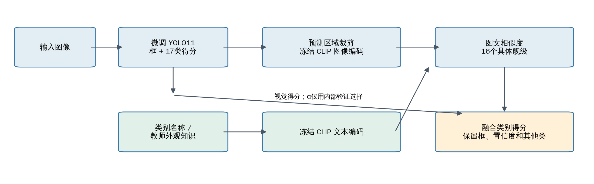

# Ship Detection · 舰船检测与图文辅助识别

基于 **YOLO11 + 冻结 CLIP ViT-B/32** 的课程实验项目：检测图像中的舰船，识别 17 个类别，并检验类别名称、外观描述能否改善细粒度识别。

项目提供数据检查与划分、检测器训练、文本后融合、COCO 评估、新图预测和 CPU 自动检查。代码整理自已完成的真实实验；参考结果与重新运行产生的结果分别保存。



## 参考结果

教师数据共 1,868 张图片、2,233 个目标框。排除 1 张跨集合近重复训练图后，划分为训练 **1,275** 张、内部验证 **215** 张、最终评估 **377** 张。最终评估沿用教师原始 `val` 图片。

| 检测器 | 方法 | mAP@0.5:0.95 | mAP@0.5 |
|---|---|---:|---:|
| YOLO11n | 纯图像 | 69.23% | 73.78% |
| YOLO11n | 外观描述融合 | 70.37% | 74.94% |
| YOLO11s | 纯图像 | **79.01%** | **83.18%** |
| YOLO11s | 外观描述融合 | 78.32% | 82.42% |

以上为随机种子 42、43、44 的均值。模型规模和各 run 的融合权重仅依据内部验证集选择。文本在较弱基线上平均略有改善，在较强的 YOLO11s 基线上未带来提升；不能据此宣称多模态方法普遍更好。标准差、逐次结果与协议说明见 [实验记录](docs/EXPERIMENTS.md)。

## 安装

本次实验验证环境为 Linux、Python 3.12、PyTorch 2.11.0+cu130、torchvision 0.26.0+cu130。先根据 [PyTorch 官方安装说明](https://pytorch.org/get-started/locally/) 安装适合本机的 torch / torchvision，再安装本项目：

```bash
git clone https://github.com/WWWXIAOLIAO/Ship-Detection.git
cd Ship-Detection
python -m venv --system-site-packages .venv
source .venv/bin/activate
python -m pip install -e ".[plots]"
```

数据解压需要系统提供 `libarchive`。新图预测支持单张 CUDA GPU，也支持 `--device cpu`；完整六组实验可在单卡上排队运行。CPU 预测不代表 CPU 训练性能已验证。

## 准备数据

自行取得教师提供的 RAR，放到本机任意位置，运行：

```bash
python scripts/prepare_data.py --archive "/path/to/任务2 基于图像与文本的舰船检测和识别.rar"
python scripts/download_weights.py
```

脚本会检查图片与标注、筛查近重复图、保留最终评估划分，并生成本机的 `configs/dataset.yaml`。原始资料保存在 `data/raw/`，派生标签和图像链接保存在 `data/processed/`。准备脚本会重建派生目录，请在训练前运行。

仓库包含代码、汇总指标与统计图。原始图片、教师文档、文本知识库、训练权重和运行缓存需在本机准备，均已配置为 Git 忽略项。

## 训练

先跑短训练，验证本机环境：

```bash
python scripts/train_detector.py --model n --device 0 --epochs 2 --batch 8 --smoke
```

正式训练单个模型：

```bash
python scripts/train_detector.py --model s --seed 42 --device 0 --epochs 100 --batch 32
```

复现两种模型、三个种子：

```bash
# 单卡依次运行；有多张卡时可改为 --devices 0 1 2 3 4 5
python scripts/run_training_suite.py --devices 0 --models n s --seeds 42 43 44
```

权重位于 `runs/yolo11s_seed42/weights/best.pt` 等对应目录。训练集每轮打乱，启用 Mosaic 等增强；训练验证和最终评估不使用训练增强。未完成的 run 可通过单模型脚本加 `--resume` 恢复；已完成 run 会由实验队列跳过。

## 评估与文本融合

```bash
python scripts/evaluate_suite.py --device 0 --text-device cuda:0
```

同一张 GPU 可同时承载两个模型。若显存或吞吐需要，可把文本模型放到另一张卡，如 `--text-device cuda:1`。只训练一组时，应明确指定同一组范围：

```bash
python scripts/evaluate_suite.py --models s --seeds 42 --device 0 --text-device cuda:0
```

流程先完成内部验证、保存 `artifacts/frozen_selection.json`，再计算最终评估指标。预测缓存校验模型权重、标注、图像内容和文本提示的哈希，输入变化会重建缓存。

## 新图片预测

使用自己训练的 17 类权重：

已有本课程完整实验包时，也可直接使用其中的 `delivery/model/best.pt`，无需重训；文本预测仍需本机准备对应的 `ship_knowledge.yaml`。仓库本身不包含微调权重。

```bash
ship-detect --image /path/to/photo.jpg --weights runs/yolo11s_seed42/weights/best.pt --device 0

# 固定正权重对照；不会读取真实标签或解析文件名中的类别
ship-detect --image /path/to/photo.jpg --weights runs/yolo11s_seed42/weights/best.pt \
  --mode descriptions --alpha 0.25 --device 0

# 无可用 GPU 时
ship-detect --image /path/to/photo.jpg --weights runs/yolo11s_seed42/weights/best.pt --device cpu
```

输出为 `outputs/predictions/` 下的标框图片与 JSON。`python scripts/infer.py ...` 与 `ship-detect ...` 等价。使用内部验证选定权重时，可传入包含 `alpha` 字段的 `--config`，格式见 [示例配置](configs/inference.example.json)。该参考 run 的描述权重为 0，表示验证选择退回视觉基线。

## 项目结构

```text
src/ship_detection/   模型推理、文本编码、后融合、COCO 评价、缓存校验
scripts/              数据准备、下载、训练、实验队列、评估、耗时测量
configs/              数据与推理配置示例
docs/                 方法、实验与运行说明
results/reference/    已完成实验的指标和逐次结果，不含图像与权重
tests/                CPU 评价协议与缓存检查
.github/workflows/    GitHub Actions 自动检查
```

## 方法与复现边界

YOLO11 在 17 类检测标注上微调；CLIP 保持冻结。文本只重判 16 个具体舰级，保留原检测框、检测置信度和 `other_ship` 决策。因此文本不能改善漏检和定位。融合公式、验证协议、稀有类别限制见 [方法说明](docs/METHOD.md)。

原生 Ultralytics 验证允许同一位置保留多个类别，实际预测每框只选一个类别。本项目最终对照统一使用后者与 pycocotools；训练曲线上的 mAP 不可直接替代最终指标。

## 检查

```bash
python -m unittest discover -s tests -v
ruff check .
ruff format --check .
```

单元检查无需 GPU、教师数据库或模型下载。GitHub Actions 运行相同的 CPU 检查。开发时另外安装 `ruff` 即可。

整理版本已完成的短训练、CPU/GPU 预测与 30 项历史评价复算记录见 [本地验证](docs/VALIDATION.md)。运行目录默认是本仓库；如需把运行产物放到其他位置，可设置 `SHIP_DETECTION_HOME`，再在该目录生成数据配置。

项目遵循 [AGPL-3.0](LICENSE)。依赖与预训练模型来源见 [THIRD_PARTY.md](THIRD_PARTY.md)。
