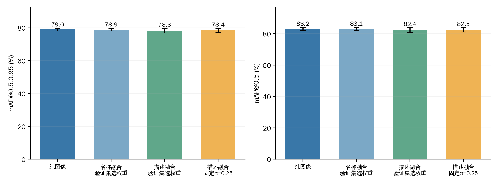
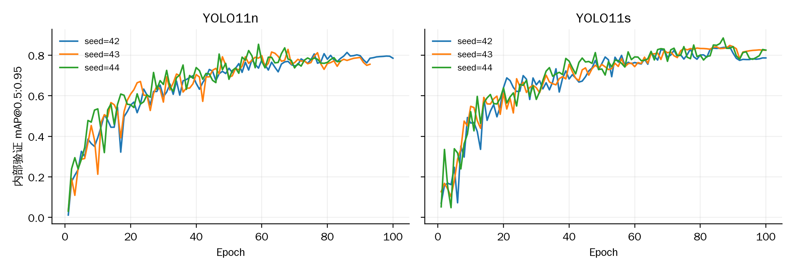

# 已完成实验的参考结果

以下数值来自 2026-11-23 的真实训练与评估，代码整理没有重新训练六组正式模型。公开代码默认支持单卡执行，原实验使用 8 张 H20，6 个 run 分别占用一张卡。默认训练设置为 100 epochs 上限、早停耐心 25、imgsz=640、batch=32、AdamW、lr0=0.001、余弦调度、weight_decay=0.0005、预热 3 轮、AMP；预设第 91 轮起关闭 Mosaic。

所有结果为种子 42、43、44 的均值 ± 样本标准差，单位为百分数。

| 模型 | 方法 | mAP@0.5:0.95 | mAP@0.5 |
|---|---|---:|---:|
| YOLO11n | 纯图像 | 69.23 ± 0.79 | 73.78 ± 0.90 |
| YOLO11n | 名称融合（验证选α） | 69.08 ± 0.93 | 73.64 ± 1.01 |
| YOLO11n | 描述融合（验证选α） | 70.37 ± 1.96 | 74.94 ± 1.65 |
| YOLO11n | 名称融合（α=0.25） | 68.99 ± 1.00 | 73.57 ± 0.99 |
| YOLO11n | 描述融合（α=0.25） | 68.62 ± 1.22 | 73.19 ± 1.32 |
| YOLO11s | 纯图像 | 79.01 ± 0.75 | 83.18 ± 0.92 |
| YOLO11s | 名称融合（验证选α） | 78.95 ± 0.81 | 83.09 ± 1.04 |
| YOLO11s | 描述融合（验证选α） | 78.32 ± 1.35 | 82.42 ± 1.55 |
| YOLO11s | 名称融合（α=0.25） | 78.98 ± 0.79 | 83.14 ± 0.92 |
| YOLO11s | 描述融合（α=0.25） | 78.40 ± 1.30 | 82.53 ± 1.43 |

YOLO11s 的内部验证平均 mAP 为 75.73%，YOLO11n 为 68.21%，因此选定 s 规模进行主要分析；最终评估没有用于该选择。展示的参考推理配置固定取 seed=42，而非按最终评估挑选种子。该 run 的名称 α=0.2、描述 α=0。

文本在 YOLO11n 上的平均提升主要来自一个种子，其他种子略有下降；YOLO11s 的描述融合平均低于纯图像基线。该结果不支持“加入文本必然改善细粒度识别”的结论，也不代表有统计显著性。

训练曲线使用训练工具原生多标签候选协议，表格使用实际推理的单标签协议，不能混用。

## 数据与复核

- [逐次实验 CSV](../results/reference/experiments.csv)
- [汇总指标 JSON](../results/reference/aggregate_results.json)
- [训练轮数与耗时](../results/reference/training_summary.json)
- [方法与评价协议](METHOD.md)

各 run 的实际训练轮数：n/42=100、n/43=93、n/44=84，s 的三个种子均为 100。新机器上的运行时间与浮点结果可能变化。重新运行的产物保存到 `runs/`、`artifacts/`，不要用新实验覆盖 `results/reference/` 中的历史记录。
